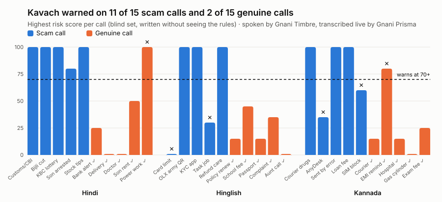

# Kavach

A real-time scam call shield for Indian families. Kavach listens to a call on
speakerphone, spots a scam as it unfolds in Hindi, Hinglish or Kannada, and
warns the listener before any money is lost: on screen with a chime during
the call, then out loud in their language once the call ends.

**Demo video:** _link coming_ · **Try it:** https://kavach-r0rl.onrender.com (live calls need the access code from the submission notes; without it, demo calls play as a scripted text demo)

Built for the Great Indian AI Internship Challenge on Gnani AI's models:

- **Gnani Prisma** (realtime speech to text) transcribes the call live, with
  word boosting for scam words like CBI, OTP, AnyDesk and UPI.
- **Gnani Timbre** (text to speech, voice cloning) speaks the warnings,
  optionally in a family member's voice.

## How it works

```
Browser mic --16 kHz audio--> Kavach server --> Gnani Prisma (live transcript)
                                    |
                     Scam detector (risk 0-100)
                                    |
              risk >= 70: warning on screen + chime
              risk >= 85: "hang up now" + helpline 1930
                                    |
            call ends: warnings read out (Gnani Timbre)
```

By default Kavach doesn't talk over the call: the caller would hear it, and
Kavach would have to stop listening while it speaks. A switch, *Speak
warnings during the call*, makes it say each warning straight away instead.

The detector looks for the shape most phone scams share: a **story**
(police, bank, courier, prize, job, tech support…), **pressure** (threats,
urgency, secrecy) and a **request** (money, an OTP, a remote-access app, a
QR code). A request inside a story or under pressure scores high, whatever
the exact words. Genuine safety advice ("the bank never asks for your OTP")
lowers the score.

It is rules, not a model, on purpose: no delay on top of Prisma, the same in
all three languages, and every warning points at the words that caused it.
When it warns, it also suggests questions to ask the caller, and after the
call it gives a short report to send to family.

## Results

All calls are synthetic. Demo and blind calls are spoken by Timbre and
streamed through Prisma at real-time speed; Prisma returned each sentence
a median 140–170 ms after it ended.

| Test | Scams warned | False alarms |
|---|---|---|
| 27 demo calls (rules tuned on these) | 18 / 18 | 0 / 9 |
| **30 blind calls** (written by a separate AI agent, run once) | **11 / 15** | **2 / 15** |
| ICFD-31k test split, 4,477 transcripts ([IJCAI 2026](https://www.ijcai.org/proceedings/2026/786)) | 61% | n/a* |
| ICFD-31k cross-domain, 961 transcripts | 26% | n/a* |

\* ICFD-31k is about 99% fraud, so false alarms are measured on Kavach's own
genuine calls.

The first rules caught only 4 of 9 new scams: they had learned the words of
my test calls, not the idea of a scam. Rebuilding them around the scam shape
raised ICFD-31k test from 11% to 61%. The remaining blind mistakes
(negation, "money into *your* account", the CVV described but not named,
thin Kannada) need understanding, not more keywords.



## Setup and run

```bash
python -m venv .venv && source .venv/bin/activate
pip install -r requirements.txt
cp .env.example .env           # paste your Gnani API key
python -m pytest -q            # 136 offline tests
python -m uvicorn app.server:app --port 8000
```

Open http://localhost:8000 in Chrome or Edge. Without a key it plays
scripted demo calls. With a key, pick the language, click *Start listening*
and put the phone on speaker, or choose *A demo call* to hear a scam spoken
by Timbre and transcribed by Prisma.

Optional, with the speaker's consent: `python scripts/clone_voice.py
reference.wav`, then `python scripts/prewarm_warnings.py` to cache every
warning in that voice.

## Hosted demo (Render)

`render.yaml` deploys Kavach as a Render web service (WebSockets and HTTPS
included; the mic needs HTTPS). In Render: **New → Blueprint**, pick this
repository, and set two secrets: `GNANI_API_KEY` and `KAVACH_ACCESS_CODE`.
The build pre-makes the warning clips. With an access code set, only people
who have it can run calls that use Gnani; everyone else gets the scripted
text demo. Calls stop after 3 minutes (`KAVACH_MAX_CALL_S`).

## Benchmark

```bash
python scripts/benchmark.py            # demo calls (--noise for a phone line)
python scripts/benchmark.py --blind    # blind set
python scripts/eval_icfd.py            # ICFD-31k, text only
```

ICFD-31k is not included; `scripts/eval_icfd.py` says how to download it.
Cite Ahuja, Prateek and Singh, *ICFD-31k*, IJCAI 2026.

## Limitations and next steps

- Synthetic calls only; next is testing on consented real audio.
- Rules miss meaning: negation, paraphrase and new scam types. Next is a
  small language model that reads the transcript when the rules are unsure.
- Speakerphone only; a phone app would remove that step.
- Kannada needs review by more native speakers.

## Privacy

No real recordings, phone numbers or ID numbers are used. Audio is not
stored. Kavach never hangs up by itself. Voice cloning only with consent.
