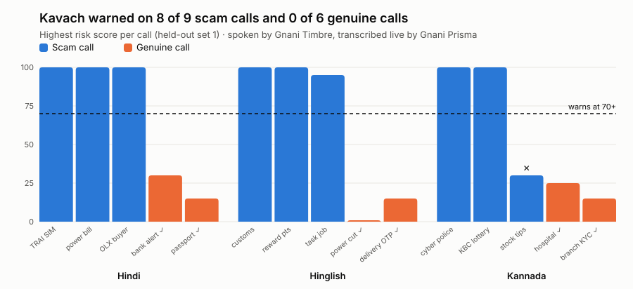
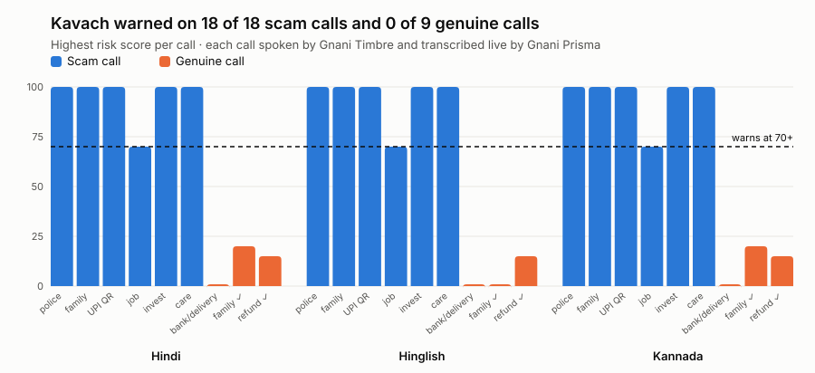

# Kavach: a real-time scam call shield for Indian families

Kavach listens to a phone call on speakerphone, spots a scam as it unfolds in
Hindi, Hinglish or Kannada, and warns the listener out loud in their own
language, optionally in a family member's cloned voice, before any money is lost.

**Demo video:** _link coming_

Built for the Great Indian AI Internship Challenge on Gnani AI's models:

- **Gnani Prisma** (speech to text, realtime WebSocket) transcribes the call live,
  with word boosting for scam vocabulary like CBI, OTP, AnyDesk and UPI.
- **Gnani Timbre** (text to speech, with voice cloning) speaks calm, clear warnings.

## The problem

Phone scams in India no longer look like spam. A caller claims to be the CBI,
a courier company, a bank or your own son on a new number, keeps you on the
line, builds fear or urgency, and talks you into moving money while you're
still on the call. "Digital arrest" calls can last hours. The people most
targeted, often parents and grandparents, are alone on the call when it
matters, and many think in Hindi or Kannada rather than English.

Kavach is the family member sitting next to them: it hears the call, knows
the shape of the common scams, and says "this is a scam, hang up" in their
language at the moment it becomes one.

## How it works

```
Browser mic --16 kHz PCM frames--> Kavach server --> Gnani Prisma (realtime STT)
                                         |
                              transcript segments
                                         v
                          Scam detector (risk 0-100)
                                         |
                       risk >= 70: spoken warning (Gnani Timbre)
                       risk >= 85: firm "hang up now" + helpline 1930
```

The detector looks for the signals that make up common Indian phone scams:
claims of police or government authority, threats of arrest, "digital arrest",
demands for secrecy, urgency, requests to move money, OTP or PIN requests,
remote-access apps, parcel stories, KYC or electricity-cut threats,
lottery or "sent by mistake" stories, family-emergency calls, "scan this QR
to receive money", paid part-time jobs, guaranteed-return investments and
fake customer care. Signals combine into a risk score, and genuine safety
advice ("the bank never asks for your OTP") lowers it. It names 13 kinds of
scam.

The detector is rules, not a model, on purpose: it adds no delay on top of
Prisma, works the same in all three languages and scripts, and every warning
can be explained by pointing at the exact words that triggered it.

When Kavach warns, it also shows the listener two or three questions to ask
the caller, such as "I'll call your office back on its official number". A
genuine caller agrees; a scammer refuses. After the call, a short report
(verdict, key moments, what Kavach said) can be copied and sent to family.

**Why Prisma and Timbre.** A warning is only useful mid-call, so speed
matters: Prisma returned each sentence about 140 ms after it ended in our
tests, and it handles Hindi, Kannada and code-mixed Hinglish. Word boosting
helps it catch the words scams depend on (CBI, OTP, AnyDesk, UPI). Timbre
speaks the warnings in the listener's language, and its voice cloning lets
the warning come in the voice of someone they trust.

## Results

Every test call is spoken by Timbre and streamed through Prisma at real-time
speed, exactly like a live call; the detector then scores Prisma's
transcript. All calls are synthetic.

There are two sets of calls, and the difference between them is the most
important result here.

| | Demo calls (tuned on) | Held-out calls (never tuned on) |
|---|---|---|
| Calls | 27: 18 scams, 9 genuine | 15: 9 scams, 6 genuine |
| Scams warned | **18 / 18** | **4 / 9** |
| False alarms on genuine calls | **0 / 9** | **0 / 6** |
| Same, over a simulated phone line | 18 / 18 and 0 / 9 | 4 / 9 and 0 / 6 |
| Median Prisma delay per sentence | 140 ms | 122 ms |

- **Demo calls** (`app/mock_calls.py`): six kinds of scam and three genuine
  look-alikes in each language. The detector's patterns were tuned on
  Prisma's transcripts of these calls, so this is close to a best case.
  Kavach warned a median 6.3 s after the first warning sign.
- **Held-out calls** (`app/unseen_calls.py`): written after tuning and never
  used for it. They are new variants (TRAI SIM block, customs parcel, reward
  points, task jobs, KBC lottery, stock tips, a fake army buyer) and genuine
  calls built to look alarming (a real bank fraud alert, police passport
  verification, a delivery that really asks for an OTP).
- **Phone line:** audio cut to the 300–3,400 Hz telephone band with
  background hiss at 20 dB. It changed no outcome in either set.

**What the held-out calls show.** Kavach caught the scams that use the
words it knows (police threats, secrecy, QR codes) and missed the ones that
say the same thing in other words: "pay a deposit and get double back",
"tell me the code", tax on a lottery prize, Kannada stock tips. It never
raised a false alarm, even on genuine calls that mention OTPs, police and
blocked cards. Keyword rules are fast and explainable but don't generalise
to new wording, which is why the next step below is a second layer that
understands meaning, not just words. With 15 calls these numbers are rough;
a larger independent test set is planned.



<details>
<summary>Chart for the demo calls (tuned on)</summary>



</details>

## Setup

```bash
python -m venv .venv && source .venv/bin/activate   # Windows: .venv\Scripts\activate
pip install -r requirements.txt
cp .env.example .env        # then paste your Gnani API key into .env
python -m pytest -q         # 102 tests, offline, no API calls
```

## Run

```bash
python -m uvicorn app.server:app --port 8000
```

Open http://localhost:8000. Use Chrome or Edge; the mic only works on
localhost or HTTPS.

- **No API key yet?** Kavach starts in demo mode and plays scripted synthetic
  calls so you can see the detector and UI working.
- **With a key:** pick the call's language, click *Start listening*, and put
  the phone on speaker next to the laptop.
- **Demo calls with a key:** choose *Listen to: A demo call*. A scripted scam
  is spoken by Gnani Timbre and streamed through Gnani Prisma exactly like a
  real call, so you hear the caller and see real transcription and scoring.

To save the demo calls as audio files (for example, to play one from a
second phone during a live test):

```bash
python scripts/export_demo_calls.py --lang hi-IN --script upi
```

## Run the benchmark

```bash
python scripts/benchmark.py                 # 27 demo calls, clean audio
python scripts/benchmark.py --noise         # the same calls over a simulated phone line
python scripts/benchmark.py --unseen        # 15 held-out calls never used for tuning
python scripts/benchmark.py --rescore       # re-score saved transcripts after a change (free)
```

Results go to `cache/benchmark*/` as `results.md`, `results.json` and
`chart.svg`. A full run takes about 4 minutes and uses Prisma and Timbre
credits; spoken lines are cached, so re-runs only use Prisma.

## Warn in a family member's voice (optional)

With their consent, record 10-20 seconds of them speaking naturally, then:

```bash
python scripts/clone_voice.py reference.wav
python scripts/prewarm_warnings.py
```

`prewarm_warnings.py` generates every warning once and caches it, so warnings
play instantly during calls and don't spend credits again. Listen to the
results in `cache/listen/`.

## Test a recorded synthetic call

```bash
python scripts/stream_file.py call.wav --lang hi-IN
```

## Project layout

| Path | What it does |
|---|---|
| `app/server.py` | FastAPI app: serves the page, relays mic audio to Prisma, sends transcripts, risk and warnings back |
| `app/stt.py` | Prisma realtime client (and a scripted stand-in for demo mode) |
| `app/lexicon.py` | The scam signals and their weights, in Latin, Devanagari and Kannada script |
| `app/detector.py` | Turns transcript lines into a risk score, level and scam type |
| `app/warnings_text.py`, `app/ask_caller.py` | What Kavach says, and the questions it suggests |
| `app/tts.py` | Timbre client: one request at a time, retries, cached clips, cloned voice |
| `app/demo_audio.py`, `app/mock_calls.py` | Spoken demo calls and their scripts |
| `app/benchmark.py`, `app/unseen_calls.py` | The end-to-end benchmark and the held-out calls |
| `static/index.html` | The whole UI: risk shield, live transcript, warnings, ask card, call report |

## Limitations and next steps

- **Synthetic calls only.** No real scam recordings were used. Real callers
  talk over each other, use regional accents and change scripts; the next
  step is testing on consented real-world audio.
- **Rules catch the scams they describe.** The held-out test shows it: 4 of
  9 new scams caught. A familiar scam in unfamiliar words slips through. The
  planned next layer is a small language model that reads the transcript
  when the rules are unsure, while the rules stay as the fast, explainable
  first line. Public synthetic datasets of Indian fraud-call transcripts,
  such as ICFD-31k (IJCAI 2026), are the next, larger test.
- **Speakerphone only.** Kavach hears the call through the laptop or phone
  microphone. A phone app or a telecom-side integration would remove that
  step.
- **Kannada was checked less than Hindi.** The Kannada patterns and warnings
  need review by more native speakers.

## Privacy and safety

- All test calls are synthetic. No real call recordings, phone numbers,
  Aadhaar or PAN numbers are used.
- Kavach never hangs up a call by itself; the person stays in control.
- Audio is streamed for transcription and not stored by Kavach.
- Voice cloning is used only with the speaker's consent.
